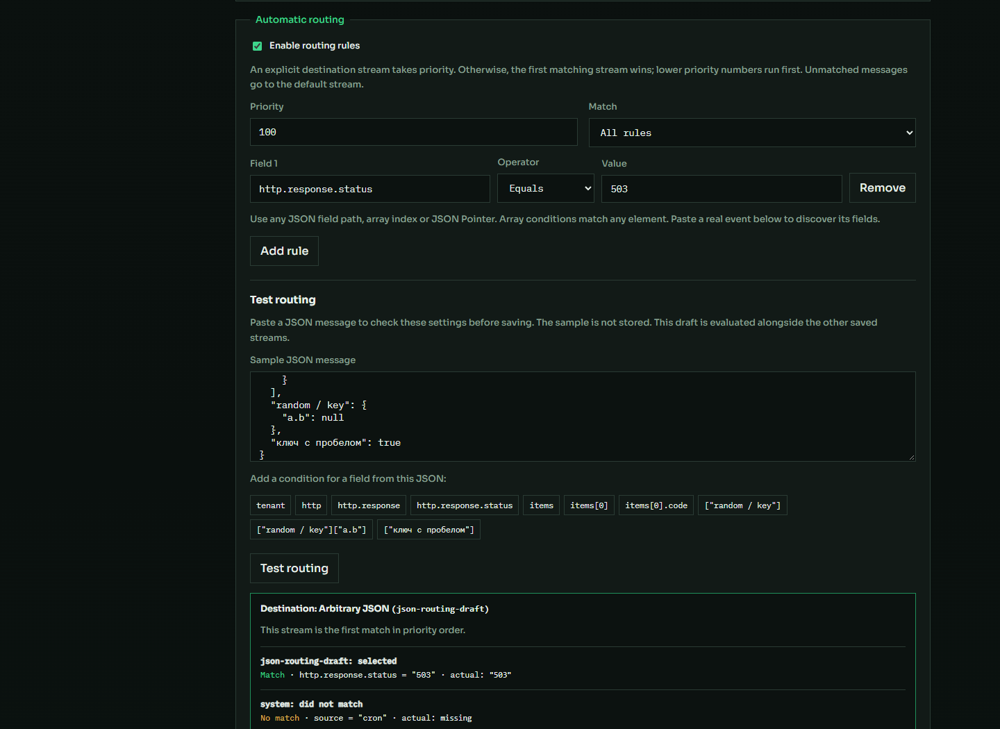

# Маршрутизация по произвольному JSON — 3 ноября 2026

Правила стримов теперь работают с любыми полями входящего JSON: верхнего уровня,
вложенными объектами, массивами, именами с точками, пробелами и Unicode.
Примеры путей: `tenant`, `http.response.status`, `items[].code`,
`["key.with.dots"]`, `/random ~1 key/a.b`. Поддерживаются сравнение, вхождение,
начало строки, наличие и отсутствие поля. Null считается существующим значением.

В **Streams & storage** можно вставить реальный JSON, выбрать обнаруженное поле,
задать условие и проверить назначение кнопкой **Test routing** до сохранения.
Предпросмотр и приём используют общий механизм правил. Поле `message` необязательно.
Приоритеты, AND/OR, явное назначение и fallback сохраняют прежнюю семантику.

Полный исходный JSON сохраняется отдельно от ограниченной поисковой проекции
и показывается в раскрытой записи. Проверены большие целые числа, экстремальные
экспоненты, длинные строки, NUL и несовместимые типы стандартных метаданных.
Новые идентичности учитывают все исходные поля; изменение произвольного поля
при повторном ID возвращает 409. Повтор старой записи совместим с прежним хешем.

## Проверки

- Go-тесты с race detector и настоящим PostgreSQL, `go vet`, сборка API.
- 27 UI-тестов и сборка UI.
- Все 28 интеграционных сценариев на изолированном `logister-check-80bc8ef8da`.
  Итоговая сверка: PostgreSQL 22 703 записи = OpenSearch 22 703, pending=0.
- Edge: выбор произвольных путей, массивы, JSON Pointer, null, мобильная ширина;
  существующие правила, предпросмотр черновика, явное назначение и ошибки JSON.
- Поиск в Edge: 101 страница изолированного стенда, фильтры, детали, ошибки и
  частичная недоступность. Повторены проверки правил и поиска на рабочем приложении.

Первый полный запуск остановился на излишне строгом сравнении счётчиков при
проверке восстановления прокси: допубликовались сообщения из файлового хвоста.
Проверка исправлена: допускает рост общего числа и независимо подтверждает
сохранность всех 200 исходных ID. Затем этот сценарий и все оставшиеся проверки
успешно выполнены на том же стенде.

[Результаты интеграционных проверок](assets/2026-11-03-arbitrary-json-acceptance.json).
После сохранения результатов временный тестовый проект и его тома удалены.

## Рабочее приложение

Проверенный API установлен с резервной копией
`api/bin/logister-api-before-json-20261103-030904`.
Исходные индексы сохранились без изменений: `logs` — 18 501,
`logs-v2` — 20 990 записей. Конфигурации стримов и хранения совпали до и после
обновления. Подтверждены поступление новых событий, health=ok и pending=0.
Браузерные проверки рабочего приложения не сохраняли тестовые стримы или правила.

Исходные поля доступны полностью для новых событий. Утраченные старой версией
поля восстановить нельзя. Произвольные свойства доступны для маршрутизации;
их сохранение не создаёт автоматически поисковые поля OpenSearch.
Ограничения размера запроса остаются прежними, см. [контракт приёма](../ingestion.md).

Синтаксис путей и настройки хранения: [стримы](../streams.md).
