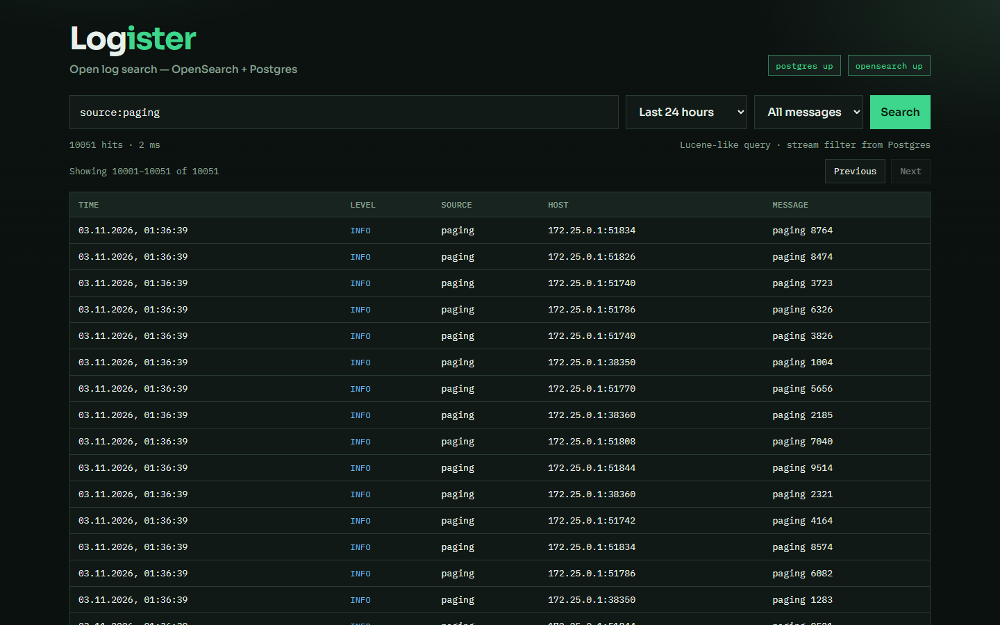

# Закрытие оставшихся замечаний Logister — 3 ноября 2026

Продолжение [исходного аудита](2026-11-03.md),
[исправлений приёма](2026-11-03-ingest-fixes.md) и
[исправлений поиска](2026-11-03-search-fixes.md).
Результат относится к текущему рабочему дереву поверх `f2b29f3`.

## Результат

Все A01–A10 и дополнительные воспроизведённые проблемы исходного аудита
исправлены в описанных ниже границах. Проверки нагрузки, аварийных завершений,
ротации и заполнения диска выполнены на отдельном стенде. Исправления применены
к работающему локальному запуску; исходные данные сохранены.

| Замечание | Итог и проверка |
| --- | --- |
| A01: повторное чтение и доставка | Постоянные позиции/очередь, стабильные ID и дедупликация в PostgreSQL; перезапуск, SIGKILL и намеренный сброс позиции не добавляют логических дублей |
| A02: частичная запись отклонённой пачки | Валидация до записи и одна транзакция PostgreSQL на всю пачку; при ошибке или ENOSPC не остаются ни префикс, ни квитанция |
| A03: ложный успех при превышении тела | Полный контроль тела; превышение лимита получает 413 до записи, в том числе без Content-Length |
| A04: техническая ошибка и старая выдача | Ошибка выражения 400, сбой поиска 503; UI очищает прежние строки/счётчики; проверено в Go, UI и Edge |
| A05: неверный частичный отказ | Независимые health/streams и статусы каждой БД; проверены автоматическое восстановление и имитация отказа в браузере |
| A06: недоступная выдача после первых страниц | PIT + подписанные курсоры search_after; пройдены все 10 050 записей с одинаковым временем, последняя страница после offset 10 000; в Edge пройдена 101 страница |
| A07: счётчик ограничен 10 000 | Точный подсчёт на настоящем OpenSearch; признак нижней границы сохранён |
| A08: неверные параметры | Валидация длительностей, переполнения, дат, порядка границ и числовых параметров; отдельные тесты |
| A09: путь HTTP-источника | Исправлены начальные данные и идемпотентное обновление старой записи; пользовательские пути сохраняются |
| A10: стиль ERROR | Стиль ошибки формы отделён; padding уровня ERROR равен 0px в настоящем браузере |
| Повтор после потери HTTP-подтверждения | Стабильные event ID либо Idempotency-Key; настоящий прокси потерял ответ после commit, восемь параллельных повторов дали 10 записей, без дублей; изменённое содержимое получает 409 |
| Конфликт типов fields | Схема flat_object сохраняет строку, число, bool, объект, массив и null в одном поле; исходный JSON возвращается без изменений |
| Пустая пачка | Отклоняется с 400; поведение закреплено тестами |
| Опечатки парсера | Исправлены Format/Time_Format, парсер включён в реальном отправщике |
| Docker/старый Compose | Используется Compose v2; все четыре образа собраны; из чистых томов запущен полный стек из шести сервисов, включая UI с API-прокси |

## Дополнительные сбои, найденные при завершении

Fluent Bit 3.2.2 после ошибки записи буфера при заполненном диске мог продолжить
чтение и пропустить строки. В пользовательском образе добавлен supervisor:
ошибка сохранения или нечистое завершение отменяют небезопасную позицию tail;
сохранённая очередь остаётся, исходные файлы перечитываются. Стабильные ID
исключают дубли. Отдельный тест проверяет последнюю ошибку диска при остановке.
После настоящего ENOSPC и освобождения раздела восстановились все 100 новых
проверочных сообщений.

Браузерная проверка после аварийных сценариев выявила HTTP 502: nginx продолжал
использовать старый адрес API. Добавлено обновление DNS через Docker resolver.
В регрессионном сценарии старый IP занял временный контейнер; API получил другой
адрес, UI восстановил health и поиск без перезапуска nginx, все данные сохранились.

## Проверки и измерения

Идентификатор изолированного стенда: `logister-check-ba7850860a`.
Использовались собственные PostgreSQL, OpenSearch, API, UI, генератор, отправщик,
порты и тома. Рабочие сервисы аварийные тесты не затрагивали. ENOSPC создавался
только на отдельных quota/tmpfs-разделах, не на диске пользователя.

| Сценарий | Подтверждённый результат |
| --- | --- |
| Генератор и ротация | 300 записей, шесть ротаций, полный набор seq и уникальных ID |
| Миграция | 200 старых записей с сохранением ID; исходный индекс остался, новый принял ещё две записи с другими типами поля |
| Снимок поиска | 10 050 записей без пропусков/повторов; поздняя запись исключена; переход назад совпал с первой страницей |
| Нагрузка HTTP | 5 000 сообщений, восемь клиентов; p95 подтверждения 44 мс; до поисковой видимости 1,143 с |
| Всплеск через отправщик | 5 000 сообщений за 4,071 с до поисковой видимости |
| Отказ OpenSearch + SIGKILL API | 400 сообщений подтверждены PostgreSQL при недоступном поиске; восстановлены без дублей |
| SIGKILL PostgreSQL | 100 ранее подтверждённых записей сохранены; после восстановления приняты ещё 50; во время отказа ответ 503/count=0 |
| SIGKILL отправщика + сброс позиции | 200 записей очереди восстановлены; повторное чтение не добавило дублей |
| Ротация | Rename-and-create и copytruncate при остановленном писателе; 600 записей сохранены |
| Полный раздел PostgreSQL | Вся пачка отклонена атомарно; после освобождения приняты 200 записей |
| Полный раздел генератора | После освобождения получены 300 корректных JSON-строк с 300 уникальными ID и полным набором seq |
| Полный раздел отправщика | Все 100 новых записей восстановлены автоматически после освобождения места |
| Новый адрес API | UI восстановил связь и поиск, сохранились все 22 617 записей |
| Итоговая сверка | PostgreSQL: 22 617; OpenSearch: 22 617; pending: 0; сверка повторена после пересоздания API |

Измерения характеризуют этот локальный прогон и не являются производственными SLA.

Прошли 16 различных интеграционных сценариев, включая итоговую сверку;
20 верхнеуровневых Go-тестов с race detector, в том числе настоящие PostgreSQL
тесты; `go vet ./...`; 15 UI-тестов; TypeScript/Vite и все Docker-сборки.
В Edge прошли семь сценариев на Docker-стенде и шесть на рабочем запуске.
[Машинные результаты интеграционных проверок](assets/2026-11-03-acceptance.json).

## Применение к работающему запуску

Старый генератор остановлен на полной строке после проверки доставки последней
записи и совпадения входных/выходных счётчиков отправщика. Сохранены:

- старый индекс `logs`: **18 501 запись**;
- исходный файл в томе логов: `/logs/pre-v2/app-20261103-014242.log`;
- API: `api/bin/logister-api-before-reliability-20261103-014242`.

Перед возобновлением генератора в `logs-v2` подтверждены те же 18 501 запись.
Обновлены только host API и два контейнера конвейера. Рабочие PostgreSQL,
OpenSearch и их тома сохранены. Новый генератор пишет стабильные ID, отправщик
работает под supervisor. Health сообщает обе БД up, `index: logs-v2` и пустую
очередь при завершении проверки. Рабочий UI прошёл браузерный smoke.

## Границы гарантий

- Дедупликация требует стабильного ID события либо повторения того же тела с
  тем же Idempotency-Key. Для произвольных клиентов без идентификаторов её нет.
  UUID отправщика защищает повтор готовой HTTP-доставки, но не перечитывание
  чужого исходного файла без собственного ID.
- PostgreSQL подтверждает приём, OpenSearch обновляется асинхронно. Очередь и
  квитанции сейчас сохраняются без автоматического удаления; нужно учитывать
  рост диска. При потерянном ответе исход commit неизвестен — безопасный повтор
  требует тех же идентификаторов.
- Восстановление позиции требует сохранённых исходных файлов. Удалённые байты,
  произвольные большие строки и потери при concurrent copytruncate не покрыты.
- PIT продлевается на две минуты каждым переходом; после простоя или перезапуска
  API нужен новый Search. Дополнительные поля имеют строковую поисковую семантику;
  типизированные числовые/датовые агрегации требуют отдельных полей.
- Проверены SIGKILL процессов и ограниченная нагрузка. Физическое отключение
  питания, отказ диска, повреждение файловой системы и все сторонние варианты
  ротации этим прогоном не проверены. Универсальная нулевая потеря данных не заявляется.

Текущие контракты: [приём и обновление](../ingestion.md), [поиск](../search.md).
