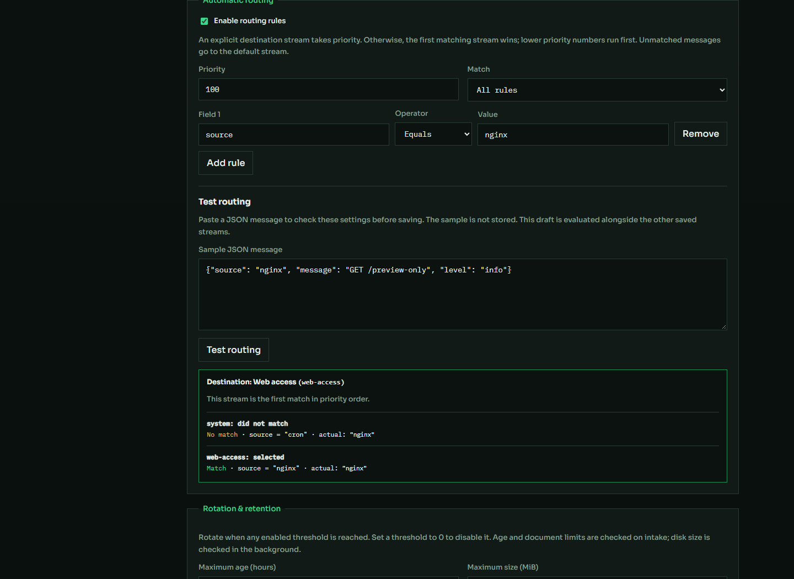

# Явные правила распределения логов — 3 ноября 2026

Устранена зависимость демонстрационного распределения от кода генератора.
Рабочий генератор передаёт source/message/level/host/fields без заранее выбранного
стрима; API использует редактируемые правила из настроек.

| Условие | Назначение |
| --- | --- |
| `source = nginx` | Web access (`web-access`) |
| `source = cron` | System (`system`) |
| Ни одно правило не совпало | Unmatched messages (`all`) |

Начальные правила устанавливаются однократно только для исходных пустых
конфигураций. Пользовательские условия, приоритеты, настройки хранения и
последующее отключение правил сохраняются после перезапуска API.

В **Streams & storage** добавлены обзор сохранённых условий и **Test routing**.
Проверка JSON показывает выбранный стрим, совпадения, значения полей, причину
fallback или обхода правил при явном назначении. Она учитывает несохранённый
черновик выбранного стрима вместе с остальными сохранёнными конфигурациями и
ничего не записывает. Реальный приём и проверка используют один evaluator.

В поиске разделены **All messages** — все стримы, и **Unmatched messages** —
только назначение по умолчанию. Для точного поиска default используется
`stream=@default`; значение в самих документах остаётся `all`.

## Проверки

Прошли 25 интеграционных сценариев на изолированном
`logister-check-128db07fdf`, 30 Go-тестов API с race detector и настоящим
PostgreSQL, `go vet`, 24 UI-теста и сборки API/UI/генератора.
Из 300 исходных сообщений каждого сценария правильно назначены nginx, cron и
прочие источники. Preview не изменил ни счётчик сообщений, ни сохранённые правила;
проверены черновик, причины выбора и отдельный поиск unmatched.
Итог: PostgreSQL 22 695 payload = OpenSearch 22 695 документов, pending=0.

В Edge прошли четыре сценария правил и семь сценариев поиска на Docker-стенде,
затем четыре сценария правил и шесть поиска на рабочем запуске. Проверены
несохранённые условия, явный стрим, неверный JSON и мобильная ширина; ошибок JS нет.
[Машинные результаты](assets/2026-11-03-routing-acceptance.json).

## Рабочий запуск

API заменён с резервной копией
`api/bin/logister-api-before-routing-20261103-023119`.
Перед заменой генератора он приостановлен на полной строке, подтверждена доставка
последнего события и пустая очередь. Старый генератор сохранён как Docker-образ,
новый запущен с тем же томом без пересоздания отправщика или БД.

Новое событие от `gateway` пришло без `stream`, получило fallback `all`;
результат настоящей доставки совпал с preview. Все прежние данные сохранены:
`logs` — 18 501 запись, `logs-v2` — 20 990 записей. Сроки хранения не менялись.

Контракт: [настройки стримов](../streams.md).
