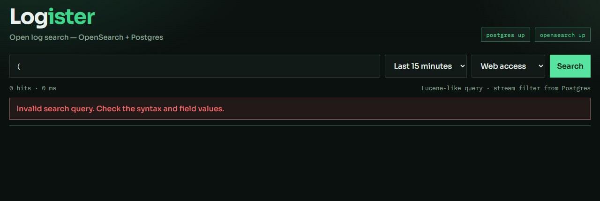

# Исправления поиска и интерфейса — 3 ноября 2026

Продолжение исправлений исходного [аудита](2026-11-03.md).

Следующий этап снял предел просмотра 10 000 записей через PIT/курсоры и завершил
остальные проверки: [итоговый отчёт](2026-11-03-reliability.md).
Ниже сохранён результат предыдущего этапа.

| Замечание | Результат |
| --- | --- |
| A04: технические ошибки и старая выдача | Ошибочное выражение получает HTTP 400 с понятным текстом; недоступный поиск — HTTP 503. Старые строки и счётчики очищаются; устаревшие ответы игнорируются |
| A05: неверные статусы при частичном отказе | Статус каждой БД сохраняется отдельно, HTTP 503 с валидным health обрабатывается. Сеть без ответа даёт unknown. Потоки и health независимы, обновляются каждые 30 секунд и восстанавливаются после отказа |
| A06: доступны только первые 100 строк | Добавлены переходы между страницами по 100 записей с сохранением применённых фильтров и границ времени. Просмотр ограничен первыми 10 000 совпадениями с явной подсказкой о сужении поиска |
| A07: счётчик останавливается на 10 000 | Включён точный подсчёт; признак нижней границы сохранён. На настоящем OpenSearch проверено 10 001 совпадение |
| A08: неверные параметры выдаются как пустая выдача/HTTP 500 | Добавлены проверки положительности и переполнения длительностей, дат, порядка диапазона, size и offset; неверные значения отклоняются до обращения к OpenSearch |
| A09: неправильный путь HTTP-источника | Исправлен init.sql и добавлено адресное идемпотентное обновление существующей записи при старте API; пользовательские пути и другие настройки сохраняются |
| A10: ERROR наследует стиль ошибки формы | У блока ошибки запроса отдельный класс; в реальном браузере padding уровня ERROR снова 0px |

## Проверки

- Новые Go-тесты и UI-тесты сначала воспроизвели ошибки исходной реализации.
- Все Go-тесты прошли с включённой проверкой на настоящем PostgreSQL;
  пользовательские данные проверка миграции не меняет: используется временная таблица.
- `go vet ./...` прошёл.
- 13 тестов интерфейса в Vitest прошли; TypeScript и Vite собираются успешно.
- Прошли 10 интеграционных сценариев доставки/приёма/поиска с настоящими Fluent Bit,
  API, PostgreSQL и OpenSearch. Временные ресурсы после проверки удалены.
- В Edge прошли шесть браузерных сценариев: загрузка, страницы, фильтры/детали/стили,
  ошибка выражения, пустой результат и имитация частичного отказа.

## Работающий запуск

API заменён проверенным бинарным файлом. Предыдущая версия сохранена локально
в `api/bin/logister-api-before-search-fixes-20261103`. Интерфейс получил изменения
через Vite. БД и отправщик не пересоздавались; доставка логов продолжается.

## Границы

Текущий просмотр ограничен 10 000 совпадениями; точный счётчик больше этого числа
не означает возможность пройти все записи без уточнения фильтров. Фиксированный
диапазон времени не является неизменяемым снимком индекса. Глубокая пагинация,
идемпотентность HTTP-доставки, неоднородные типы fields и остальные дополнительные
наблюдения исходного аудита остаются отдельными задачами.

Контракт и команды проверок: [docs/search.md](../search.md).
