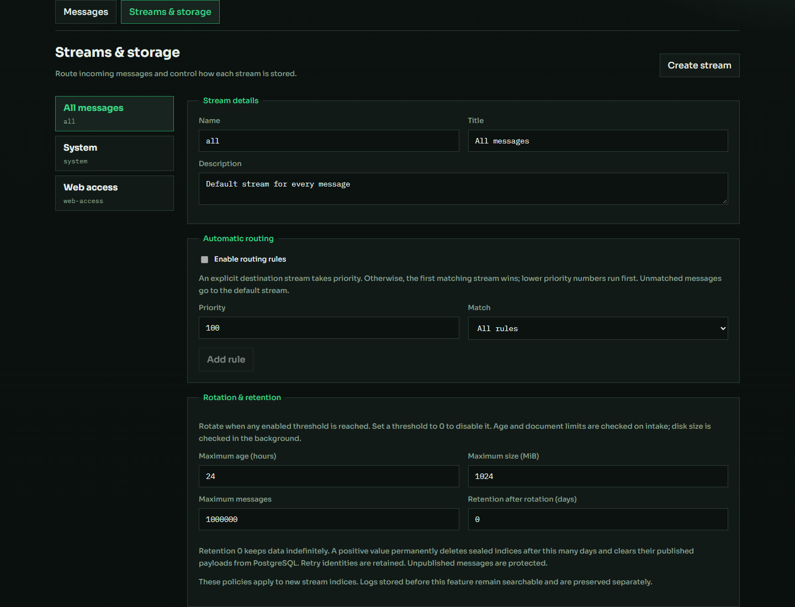

# Настройки стримов, маршрутизации и хранения — 3 ноября 2026

Реализовано поверх `fc10606`; изменения этой итерации пока не закоммичены.
Применено к локальному рабочему запуску около 02:12 по Москве.

## Возможности

В разделе **Streams & storage** доступны:

- создание стрима и изменение названия для отображения/описания;
- правила по source, host, level, facility, message и дополнительным полям;
  точное совпадение, подстрока, префикс, AND/OR и приоритет;
- ротация индексов по возрасту, размеру primary storage или количеству сообщений;
- срок хранения закрытых поколений, по умолчанию 0 — удаление выключено;
- просмотр последних 100 поколений, счётчиков и размеров, ручная ротация;
- отправка сообщения в выбранный стрим и поиск по нему.

Имя стрима неизменно. Явный стрим в сообщении или URL имеет приоритет над
правилами. Без явного назначения выбирается первое совпадение по приоритету и
имени; иначе используется `all`. Неизвестное назначение отклоняет всю пачку.

Добавлены API создания/обновления, просмотра индексов, ручной ротации и
`POST /api/streams/{name}/ingest`. Конфигурация сохраняется в PostgreSQL.

## Надёжность и совместимость

Физический индекс назначается событию в той же транзакции, которая подтверждает
приём. Ротация не меняет уже назначенные адреса: повтор после потерянного ответа
не создаёт документ в другом поколении. Повторы не увеличивают счётчик ротации.
Изменение правил также не перемещает ранее принятые события.

Общий read alias `logs-v2-read` охватывает прежний `logs-v2` и новые индексы
стримов. Поиск с PIT/курсорами продолжает работать, включая страницы после
10 000 результатов и переходы через момент ротации.

Фоновый процесс проверяет размер/возраст примерно раз в 10 секунд. Возраст и
число сообщений дополнительно проверяются при приёме. После закрытия индекс
сменяется следующим только при новом сообщении. Незавершённая доставка в старое
поколение допускается и сохраняет его назначение.

Retention удаляет только закрытые управляемые индексы после настроенного числа
дней с момента закрытия. Активные индексы и поколения с неопубликованными
событиями защищены. После подтверждения OpenSearch удаляются опубликованные
payload из PostgreSQL; ID/хеши и квитанции остаются для дедупликации. Повтор
истёкшего события не восстанавливает его. Неподтверждённый ответ удаления не
позволяет очистить payload.

Legacy-индексы `logs` и `logs-v2` сохранены и исключены из автоматического
удаления. Для всех существовавших стримов retention оставлен выключенным.
Источник ротации — сам Logister; ISM-политики OpenSearch не назначаются.

## Проверки

Изолированный проект: `logister-check-ef338dac74`. Его собственные PostgreSQL,
OpenSearch, тома и порты не затрагивали рабочие сервисы при аварийных сценариях.

| Проверка | Результат |
| --- | --- |
| Правила и явное назначение | Приоритет, AND/OR, числовое поле, явное назначение и атомарное отклонение неизвестного стрима подтверждены |
| Изменение правил перед повтором | 3 повтора подтвердились как дубли; старое назначение сохранилось |
| Ротация по количеству | 5 сообщений распределены как 2/2/1; повтор не создал новое поколение |
| Ручная ротация и PIT | Следующее событие получило новое поколение; уже открытый снимок сохранил 5 записей |
| Ротация по возрасту | Индекс с настройкой 1 час закрыт без новых сообщений; пустой преемник не создавался |
| Ротация по размеру | При лимите 1 MiB измерены 7 678 767 байт primary storage; индекс закрыт, следующее событие ушло в новое поколение |
| Retention | Просроченный индекс удалён, активный сохранён, payload очищен, повтор не восстановил истёкшее событие |
| Retention при отказе поиска | Неопубликованное событие защищало поколение; удаление произошло после восстановления и публикации |
| Перезапуск API | Настройки сохранились; повтор имени получил 409 |
| Ошибка выражения по alias | Ошибка на части шардов при HTTP 200 распознаётся как пользовательская 400; инфраструктурные ошибки остаются 503 |
| Итоговая сверка | 22 695 сохранённых payload в PostgreSQL = 22 695 документов OpenSearch; pending=0 |

Все **24 интеграционных сценария** прошли, включая прежние проверки нагрузки,
SIGKILL, восстановления, потери подтверждения, ротации файлов и ENOSPC.
Проверка PostgreSQL ENOSPC гарантирует выделение нового блока в той же
транзакции: свободные страницы существующей таблицы не дают ложного успеха теста.

Прошли **27 Go-тестов API с race detector**, в том числе проверки на настоящем
PostgreSQL; `go vet`; **21 UI-тест**; TypeScript/Vite и Docker-сборки API/UI.
В Edge прошли шесть сценариев стримов и семь сценариев поиска на тестовом
Docker-стенде, затем настройки и шесть поисковых сценариев на рабочем запуске.
Проверены desktop и мобильный экран, ошибок JavaScript нет.

Сырые результаты: [JSON](assets/2026-11-03-streams-acceptance.json).

## Применение

Перед заменой API в `logs-v2` было 20 990 записей; проверка после обновления
подтвердила сохранность. Исходный backup `logs` с 18 501 записью не изменялся.
Прежний бинарник сохранён:
`api/bin/logister-api-before-streams-20261103-021235`.

API сообщает `index: logs-v2`, `search_index: logs-v2-read`, обе БД up и пустую
очередь при завершении проверок. Генератор/отправщик и рабочие тома не
пересоздавались; новые записи поступают в поколения соответствующих стримов.

## Границы

Политики действуют на новые управляемые индексы, не удаляя legacy-данные.
Retention отсчитывается от закрытия поколения; снижение срока распространяется
и на ранее закрытые управляемые поколения. Размер проверяется периодически и
может превышать порог до очередной проверки. Открытый PIT может ещё показывать
истёкшие данные до завершения своей жизни. Квитанции/хеши и исходные файлы
автоматически не удаляются. Полный контракт: [настройки стримов](../streams.md).
