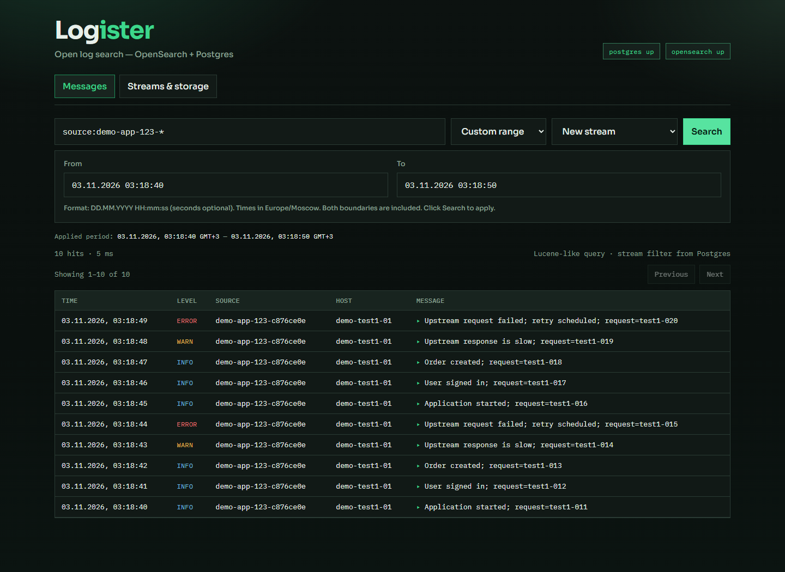

# Поиск в выбранном интервале — 3 ноября 2026

В селектор периода добавлен **Custom range** с полями **From** и **To**.
Системный datetime-picker заменён текстовыми полями `ДД.ММ.ГГГГ ЧЧ:ММ:СС`,
чтобы колесо мыши и стрелки не меняли выбранные значения. Допускаются минуты
без секунд и вставка локальной ISO-даты. Черновик сохраняется при переключении
быстрых периодов.
Дата и время вводятся до секунд в часовом поясе браузера; API получает UTC.
Под формой отображается фактически применённый период с часовым смещением.
Пустые, некорректные, равные и обратные границы блокируются до запроса.
Переходы между страницами используют прежний интервал снимка независимо
от несохранённых изменений дат. Быстрые относительные периоды сохранены.

При проверке реальных данных найден и исправлен дефект API: RFC3339Nano
убирал нулевую дробную часть, после чего верхняя граница могла включать
остаток секунды. Оба пути поиска теперь передают границы как `epoch_millis`.
Это соответствует миллисекундной точности используемого типа `date`.
Поведение неполных дат описано в [документации OpenSearch](https://docs.opensearch.org/latest/query-dsl/term/range/).

Проверки:

- 42 UI-теста, проверка TypeScript и сборка UI.
- Все Go-тесты с race detector и настоящим PostgreSQL, `go vet`, сборка API.
- Edge с часовым поясом Europe/Moscow: выбранные 10 секунд возвращают ровно
  10 нужных записей `new-stream`; проверен полный набор ID.
- Реальные события `cron`: обе точные границы включены, состав результатов
  совпадает с ожидаемым. Проверены валидация, пагинация, переключение периодов,
  мобильная ширина и существующие сценарии поиска/просмотра полей.
- В Edge отдельно воспроизведены прокрутка колесом и нажатия стрелок при фокусе
  в обоих полях: введённые даты остаются прежними, запрос поиска не отправляется.

API установлен с копией `api/bin/logister-api-before-time-20261103-033733`.
Индексы `logs` (18 501) и `logs-v2` (20 990), настройки всех четырёх стримов
сохранены. После установки подтверждены поступление событий, health=ok и pending=0.

