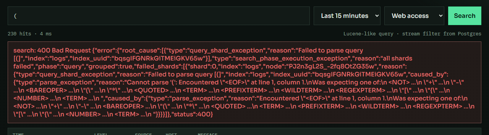

# Проверка существующего функционала Logister

Проверка проведена в ночь со 2 на 3 ноября 2026 года (Москва).
Версия: `f2b29f3` (`main`). Код приложения при проверке не изменялся.

После аудита исправлены A01 и A03, для A02 добавлена предварительная валидация
всей пачки и подтверждение частичного успеха при ошибке хранения.
См. [результаты исправлений](2026-11-03-ingest-fixes.md) и
[границы гарантий приёма и доставки](../ingestion.md). Исходные наблюдения ниже
сохранены как результаты проверки исходной версии.

Следующим этапом исправлены поиск, индикация сервисов, просмотр страниц и путь
источника: [результаты A04–A10 и оставшиеся границы](2026-11-03-search-fixes.md).

Оставшиеся замечания закрыты последующим этапом: [итоговый отчёт с проверками
нагрузки, аварий, ротации и заполнения диска](2026-11-03-reliability.md).
Ниже сохранены исторические наблюдения исходной версии.

## Результат

Основной сценарий работает: генератор пишет JSON, Fluent Bit доставляет сообщения
в API, API сохраняет их в OpenSearch, интерфейс выполняет поиск. PostgreSQL
возвращает метаданные потоков и источников. Однако обнаружены проблемы
целостности приёма, повторной доставки, обработки ошибок и отображения результатов.

Приоритеты: P1 — целостность данных; P2 — корректность существующих операций;
P3 — небольшие проблемы интерфейса. Указанные ниже проблемы воспроизведены,
кроме отдельно отмеченных наблюдений о конфигурации и окружении.

## Что проверено

| Область | Результат |
| --- | --- |
| UI: начальная загрузка, обычный поиск | Работают, ошибок JavaScript не обнаружено |
| Поиск `level:error` | Возвращает сообщения уровня error |
| Фильтры времени и потока `web-access` | Работают после нажатия Search |
| Раскрытие дополнительных полей сообщения | Работает |
| Поиск без совпадений | Корректные `total: 0`, `messages: []`, пустое состояние UI |
| `GET /api/health`, `/api/streams`, `/api/inputs` | Успешные ответы при исправных сервисах |
| Приём одного JSON, массива, оболочки Fluent Bit `log` | Успешен, сообщения доступны в поиске |
| Пустое тело, отсутствующий message, повреждённый JSON | Отклоняются с HTTP 400 |
| Некорректная дата в timestamp | Отклоняется с HTTP 400; текст ошибки общий: `invalid json` |
| `npm run build` | Успешно: TypeScript и Vite |
| `go test ./...` | Пакеты собираются; во всех пакетах `no test files` |
| `go vet ./...` | Успешно |
| `docker-compose build api ui` | Go-код скомпилировался на стадии build; полная сборка не завершена из-за зависшей загрузки `alpine:3.20`. Проверочная сборка остановлена, результат UI Docker-сборки не установлен |
| Рабочие контейнеры | PostgreSQL и OpenSearch healthy; генератор и Fluent Bit работают |

HTTP-проверки приёма и объёма результатов выполнялись на отдельном экземпляре
того же API, порт 8081, индекс `logister-audit-20261102-01`, с отключённым seed.
Рабочий индекс `logs` не использовался для записи тестовых сообщений.
Тест повторной доставки использовал отдельный временный контейнер Fluent Bit.
После проверки тестовый контейнер и индекс удалены, отдельный API остановлен.
В браузере использовался установленный Edge через Python Playwright:
встроенный браузер Codex не был подключён.

## A01 — P1: повторная отправка файла после перезапуска Fluent Bit

В отдельный файл записаны три JSON-строки. Отправщик с текущей конфигурацией
доставил три сообщения. После перезапуска того же тестового контейнера без
изменения файла в индексе стало шесть сообщений.

В [конфигурации](../../deploy/fluent-bit/fluent-bit.conf#L14) включён
`Read_from_Head On`, но нет сохраняемой базы позиций чтения `DB`.
API при повторном получении создаёт новые документы с новыми ID.

Результат: обычный перезапуск отправщика повторно добавляет уже прочитанные логи.
Нужно сохранять позицию чтения в постоянном томе и отдельно определить поведение
при повторных HTTP-доставках. Это не обещание доставки «ровно один раз»:
повтор после потери HTTP-подтверждения требует отдельного решения.

## A02 — P1: отклонённая пачка частично записывается без подтверждения

Повторить дважды:

```http
POST /api/ingest/json
Content-Type: application/json

[{"message":"audit partial validation","source":"audit-partial"},{"source":"audit"}]
```

Оба ответа — HTTP 400, `message is required`. При этом поиск
`source:audit-partial` находит две записи: первая строка каждого запроса сохранена.

В [цикле приёма](../../api/internal/httpapi/server.go#L264) валидация и запись
выполняются последовательно для каждого элемента. Ошибка следующего элемента
не сообщает клиенту, какие записи уже приняты. Повтор всей пачки создаёт дубли.

Нужно проверить всю пачку до начала записи и определить явный результат частичного
успеха при ошибках хранения. Предварительная валидация сама по себе не обеспечивает
атомарность записей в OpenSearch.

## A03 — P1: превышение лимита тела запроса может завершаться ложным успехом

Отправлено тело: корректный JSON-объект, пробелы до размера 1 МиБ,
затем `THIS_IS_INVALID_TRAILING_JSON`. Полное тело не является корректным JSON
и превышает лимит. Фактический ответ — HTTP 202, `count: 1`.

[LimitReader](../../api/internal/httpapi/server.go#L233) молча отбрасывает всё
после первого МиБ. Парсер видит только корректный префикс.
Нужно обнаруживать превышение лимита и отвечать HTTP 413 до индексирования.

## A04 — P2: ошибки поискового выражения выдаются как сбой сервера

Поиск `(` возвращает HTTP 500. В сообщении API находится полный технический
JSON OpenSearch с идентификаторами индекса и узла, а интерфейс показывает его
целиком. Под ошибкой остаются предыдущие 100 строк и старый счётчик совпадений.

Источники: [handleSearch](../../api/internal/httpapi/server.go#L161),
[runSearch](../../ui/src/App.tsx#L50). Нужно отличать ошибку пользовательского
запроса от недоступности хранилища, показывать понятное сообщение и явно обозначать
старые результаты либо очищать их.



## A05 — P2: неверное состояние сервисов при частичном отказе

В браузере подменён только ответ `/api/health`: HTTP 503,
`postgres: true`, `opensearch: false`. Реальные контейнеры не останавливались.

Интерфейс показал `postgres down` и `opensearch down`, а список потоков сократился
до `all`, хотя `/api/streams` возвращал корректные данные.

[getJSON](../../ui/src/api.ts#L35) отбрасывает полезное тело ответа 503,
а [loadMeta](../../ui/src/App.tsx#L39) объединяет запросы через `Promise.all`:
одна ошибка отменяет обновление обоих состояний. Дополнительно health загружается
только при открытии страницы — без последующего обновления.

Нужно сохранять полученные статусы по отдельности и различать отказ сервиса,
отсутствие ответа и ещё не загруженное состояние.

## A06 — P2: интерфейс не даёт просмотреть результаты после первых 100

В проверенном сеансе интерфейс сообщил 6708 совпадений и отобразил 100 строк.
Перехода к следующей странице, загрузки следующей порции или настройки размера нет.

[Клиент поиска](../../ui/src/api.ts#L52) передаёт `size: 100`, но не передаёт offset.
API уже поддерживает offset. Это ограничение существующего просмотра результатов,
которое нужно учитывать при приведении поиска в порядок.

## A07 — P2: счётчик скрывает ограничение в 10 000 совпадений

В отдельный индекс добавлено 10 001 сообщение с `source: audit-total`.
Поиск только этого источника вернул `total: 10000`.

[Поисковый запрос](../../api/internal/search/client.go#L165) не запрашивает
точный подсчёт, а [разбор ответа](../../api/internal/search/client.go#L197)
сохраняет `hits.total.value` без `hits.total.relation`.
UI показывает нижнюю границу как точное число.

Нужно либо получать точное число, либо передавать признак нижней границы
и отображать `10 000+`.

## A08 — P2: некорректные параметры поиска не проверяются последовательно

| Запрос | Фактический результат |
| --- | --- |
| `relative=0s` | HTTP 200, пустая выдача |
| `relative=-1h` | HTTP 200, пустая выдача |
| `relative=106752d` | HTTP 200 после переполнения time.Duration |
| `from` позже `to` | HTTP 200, пустая выдача |
| `size=abc` | HTTP 200, молчаливый переход на размер по умолчанию |
| `offset=10001` | HTTP 500 с технической ошибкой окна OpenSearch |

Источники: [parseRelative](../../api/internal/httpapi/server.go#L52),
[handleSearch](../../api/internal/httpapi/server.go#L117).
Нужны положительные интервалы без переполнения, упорядоченный диапазон,
проверка числовых параметров и понятные ошибки HTTP 400.

## A09 — P2: источник HTTP JSON сообщает неверный путь приёма

`GET /api/inputs` возвращает для `http-json` значение
`config.path: /ingest/json`. POST по этому пути получает HTTP 404.
Рабочий маршрут — `/api/ingest/json`.

Источник: [начальные данные PostgreSQL](../../deploy/postgres/init.sql#L28).
Исправление только init.sql не обновит уже заполненную БД:
для существующей записи потребуется отдельное обновление.

## A10 — P3: CSS ошибки формы применяется к уровню ERROR в таблице

У элемента уровня сообщения классы `level error`. На него одновременно
действует общий селектор [.error](../../ui/src/styles.css#L155), предназначенный
для блока ошибки запроса.

Проверка браузером: ERROR получает padding `12px 14px`, рамку `1px`
и фон; INFO имеет padding `0px` и рамку `0px`. Это увеличивает строки
и визуально превращает уровень сообщения в сообщение об ошибке формы.
Нужно ограничить селектор блоком ошибки либо разделить имена классов.

## Дополнительные подтверждённые ограничения

- Типы дополнительных полей общие для индекса. После записи
  `fields.conflict_value: "text"` сообщение с объектом в том же поле
  отклоняется OpenSearch; API отвечает HTTP 500 с `mapper_parsing_exception`.
  Нужны понятная обработка такого отказа и определённые правила типов полей.
  Стратегия совместимости неоднородных источников пока не определена.
- Пустая пачка `[]` принимается как HTTP 202, `count: 0`. Это не потеря данных,
  но желаемое поведение и контракт API стоит зафиксировать тестом.
- В parsers.conf есть опечатки `Fomat` и `Time_Fomat`, но текущий tail-input
  не использует этот parser. Оболочка `log` сейчас разбирается в API.
  Считать parser рабочим по наличию файла нельзя.
- В текущем окружении установлен Docker Compose 1.29.2. При попытке запуска
  PostgreSQL из новой папки он ранее завершился с `KeyError: ContainerConfig`.
  Существующий контейнер был восстановлен и работает. Это проблема
  воспроизводимости запуска в окружении; не ошибка бизнес-логики API.
- Полный нагрузочный тест, длительная недоступность хранилищ, восстановление
  после аварийного отключения и доставка через все варианты ротации файла
  не проверялись. Нулевую потерю сообщений эти проверки не доказывают.

## Порядок исправления

1. A01–A03: позиция чтения, подтверждение пачек, лимит запроса.
2. A04, A07, A08: ошибки поиска, достоверный счётчик и валидация параметров.
3. A05, A06, A09, A10: статусы, доступность всей выдачи, путь источника, оформление.
4. Добавить регрессионные тесты для подтверждённых проблем и проверить
   воспроизводимость Docker-запуска. После этого повторить тот же набор сценариев.

Во время этой проверки исправления приложения и отправка изменений в GitHub
не выполнялись. Сырые результаты и временные проверочные скрипты сохранены
локально в `graphify-out/audit/` (папка исключена из Git).
